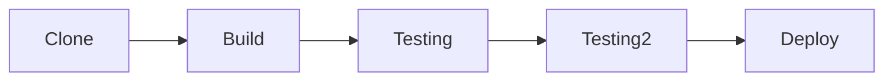

# Project 1 – Jenkins Docker Pipeline

   

> A web app built into a Docker image and deployed by a Jenkins pipeline.

## Overview

A static site served by **Apache httpd (Alpine)**. The **Jenkins** pipeline clones the repo, builds a versioned image (`appx:v<BUILD_NUMBER>`), runs test stages and deploys the container.

## Tech Stack

- **Jenkins**
- **Docker**
- **Apache httpd**
- **HTML/CSS**

## Repository Structure

```text
app/file1
app/file2
Dockerfile
index.html
Jenkinsfile
README.md
```

## Getting Started

### Run with Docker

```bash
git clone https://github.com/Gamal-Mohammad/project1.git
cd project1
docker build -t project1 .
docker run -d --name project1 -p 8080:80 project1
```

Then open http://localhost:8080.

## CI/CD Pipeline

The `Jenkinsfile` defines the following stages:



## Author

**Gamal Mohammad**

[](https://github.com/Gamal-Mohammad)
